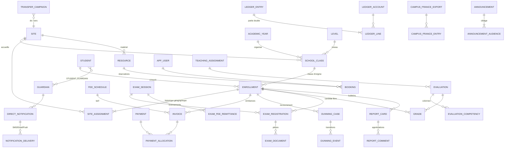

# 1. Modèle de données

> Référence exécutable : [`db/schema.sql`](../db/schema.sql) (structure), [`db/functions.sql`](../db/functions.sql) (règles métier),
> [`db/seed.sql`](../db/seed.sql) (référentiels) et [`db/tests.sql`](../db/tests.sql) (8 scénarios de vérification).
> SGBD cible : **PostgreSQL ≥ 14** (contraintes d'exclusion, `daterange`/`tstzrange`, `jsonb`).

## 1.1 Principe directeur : tout s'accroche à l'inscription

La difficulté centrale de l'établissement est la **mobilité en cours d'année** (1re/Tle de Tamatave → Tana en avril).
Le modèle sépare donc trois notions que les logiciels du marché confondent souvent :

| Notion | Table | Change en avril ? |
|---|---|---|
| **Qui** est l'élève | `student` | non |
| **Inscription** annuelle (classe d'origine, année) | `enrollment` | **non** |
| **Lieu** où l'élève est physiquement accueilli | `site_assignment` (historisée par `daterange`) | **oui** : une nouvelle ligne |

Notes, compétences, bulletins, factures, paiements, dossiers d'examen et relances référencent tous `enrollment_id`.
Le transfert (`execute_transfer_campaign`) **ferme** l'affectation Tamatave la veille de la bascule et **ouvre** une affectation
Tana (`reason = TRANSFERT_EXAMEN`). Aucune ligne pédagogique ou financière n'est déplacée ni copiée ; une contrainte
`EXCLUDE` interdit deux affectations simultanées. La vue `v_current_site` donne le site du jour et sert au filtrage par site.

## 1.2 Diagramme entité-relation (simplifié)

## 1.3 Domaines et entités

### Structure & multi-sites
- **`site`** (TANA, TMV) et **`site_cycle`** : Tamatave n'ouvre que Collège + Lycée, Tana les quatre cycles.
- **`academic_year`**, **`period`** (trimestres), **`level`** (PS → Tle, avec l'examen officiel associé : 3e → DNB, Tle → Bac).
- **`school_class`** : rattachée à un site, un niveau et une filière (`GENERALE` / `STMG`, à partir de la 1re).

### Comptes, rôles, SSO
- **`app_user`** : `google_sub` stocke l'identifiant OIDC Google. **`sso_allowlist`** : les comptes Gmail personnels ne
  permettent pas de filtrer par domaine, on n'autorise donc que les adresses invitées.
- **`user_role`** (+ `site_id` NULL = tous sites) et **`role_permission`** : les droits portent sur le **rôle**, jamais sur la
  personne. La Cheffe d'établissement et la Directrice adjointe ont toutes deux le rôle `DIRECTION` sans restriction de site :
  leurs droits sont identiques par construction (scénario T1). Seul le libellé (`title`) les distingue.

### Finances : comptabilité séparée
| Élément | Rôle |
|---|---|
| `fee_category` | `ECOLAGE` ou `DROITS_EXAMEN`, porté par chaque tarif, facture, paiement et écriture |
| `ledger_account` | plan de comptes où **chaque compte appartient à une seule catégorie** |
| `ledger_entry` / `ledger_line` | journal en partie double ; un trigger refuse toute ligne visant un compte d'une autre catégorie (T5), un trigger différé vérifie l'équilibre débit = crédit |
| `fee_schedule.retained_fee_mga` | part conservée par l'école sur les droits d'examen (**40 000 Ar**) |
| `exam_fee_remittance` | reversements aux centres d'examen (solde le compte `EXA-A-REVERSER`) |

Écriture générée par `record_exam_fee_payment` pour un droit de Bac de 600 000 Ar (T4) :

| Compte | Débit | Crédit |
|---|---:|---:|
| `EXA-CAISSE` (trésorerie droits d'examen) | 600 000 | |
| `EXA-FRAIS-DOS` (produit : frais de dossier) | | 40 000 |
| `EXA-A-REVERSER` (dette envers le centre) | | 560 000 |

Les 560 000 Ar ne sont **jamais** comptés en produit : c'est une dette, soldée lors du reversement.

### Échéancier & relances
- **`dunning_month`** : calendrier paramétrable. Seed : septembre, novembre, décembre, février, avril, mai, juin actifs ;
  **octobre inactif** (motif « Encaissement des droits d'examen »). Pendant un mois inactif le cycle est **gelé** : aucune
  ouverture, aucune progression (`advance_dunning_case`).
- **`tuition_cutoff_rule`** : dernier mois payable par site × niveau. Seed : 1re et Tle de Tamatave → **mai**. Un trigger
  refuse toute facture d'écolage au-delà de ce mois (T3).
- **`dunning_case`** / **`dunning_event`** : machine à états `RELANCE → AVERTISSEMENT_48H → MISE_A_PIED`, chaque transition est
  historisée. La mise à pied exige la **validation explicite d'un compte Direction** (`suspension_validated_by`).

### Temps & réservations
- **`school_day`** : 7h–17h, mercredi 7h–12h, par site. **`break_slot`** : récréation commune (`class_id` NULL, 9h30–9h45) et
  pauses déjeuner **par classe et par jour** (dynamiques).
- **`resource`** (TV, vidéoprojecteur, enceinte, salle spécialisée, informatique), rattachée à un site.
- **`booking`** : `period tstzrange` + contrainte
  `EXCLUDE USING gist (resource_id WITH =, period WITH &&) WHERE status = 'CONFIRMEE'`. La base rend tout chevauchement
  **impossible**, y compris en cas de requêtes concurrentes ; des créneaux contigus (10h–11h puis 11h–12h) restent acceptés (T7).

### Évaluations & bulletins
- **`evaluation`** + **`evaluation_competency`** (colonnes de la grille) + **`competency_result`** (niveau de maîtrise 1–4).
- **`grade.raw_input` / `autocorrected`** : la saisie brute (« 1O ») est conservée pour l'audit à côté de la valeur retenue.
- **`subject.grading_mode = APPRECIATION_SEULE`** + `opening_strand` (NUMERIQUE / ORIENTATION / ART) : le **Parcours
  d'ouverture**, sans note. `opening_session` trace les 1 à 2 séances mensuelles.
- **`report_comment.rule_check`** (jsonb) : résultat du contrôleur de rédaction. Une contrainte `CHECK` empêche le statut
  `VALIDE` tant qu'il reste des erreurs (T8). `report_card.decision_text` doit commencer par `Admis.e`, `Retenu.e` ou `Réorienté.e`.

### Examens & dossiers externes
- **`exam_session`** (DNB, Pré-Bac, Bac × centre × année, Académie de La Réunion), **`exam_registration`** (candidat libre,
  statut du dossier, facture de droits), **`exam_document`** (pièces justificatives par type).
- **`campus_france_campaign`** (fenêtre juillet → début septembre), **`campus_france_export`** / **`campus_france_entry`** :
  traçabilité de chaque fichier envoyé.

### Communication
- **`announcement_audience`** : chaque ligne est un filtre (rôle × site × niveau × classe, colonnes NULL = sans restriction).
  ET entre colonnes d'une ligne, OU entre lignes. Exemples : `(TOUS)` = toute l'école ; `(PROFESSEUR)` ;
  `(PARENT, TMV, TLE)` = parents de Terminale à Tamatave ; `(TOUS, classe=1re STMG A)`.
- **`direct_notification`** : notification individuelle d'un parent pour un motif (`RETARD`, `DISCIPLINE`,
  `DOCUMENT_MANQUANT`, `IMPAYE`…), avec un suivi d'envoi **par canal** (`notification_delivery`).

### Transverse
- **`audit_log`** : toute action sensible (transfert, modification de note, encaissement, validation de mise à pied).
- Montants en **Ariary entiers** (`bigint`), horodatages `timestamptz` (fuseau `Indian/Antananarivo`).

## 1.4 Hypothèses à valider avec la Direction

1. **Janvier et mars** ne figurent pas dans les mois de relance : ils sont modélisés « hors cycle » mais restent
   facturables. Modifiable sans code (`dunning_month`).
2. **« Mai, dernier mois payable »** est interprété comme : aucune échéance d'écolage n'est générée après mai pour les
   1re/Tle de Tamatave, et le solde éventuel apparaît dans le *quitus financier* de la campagne de transfert.
3. Le **transfert n'est pas bloqué** par un impayé (l'élève doit passer ses épreuves) : la campagne remonte la liste des soldes
   à suivre. Le paramètre `requires_financial_clearance` permet de durcir la règle si souhaité.
4. Les délais du workflow d'impayés (J+5 pour la relance, J+7 pour l'avertissement) sont des valeurs par défaut à confirmer.
